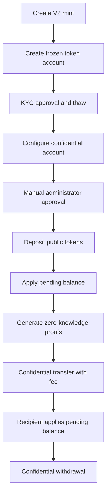

# Solana Token-2022: Regulated Tokens and Confidential Transfers


## Overview

This project was developed as part of the Solana
Development Cohort Week 4 assignment.

It demonstrates how Solana Token-2022 extensions can
be combined to support regulated digital assets,
compliance controls, confidential balances,
encrypted transfer fees, and token migration.

The project extends the original Solana Foundation
Confidential Balances Sample with additional
functionality, integration tests, compatibility
fixes, and a security investigation.

## Project Objectives

- Understand the Token-2022 extension architecture.
- Create regulated token mints.
- Implement simulated KYC approval controls.
- Calculate and collect public transfer fees.
- Implement Permanent Delegate authority.
- Enable manually approved confidential accounts.
- Execute confidential transfers with encrypted fees.
- Implement atomic token balance migration.
- Investigate administrative asset-recovery limitations.

## Implementation

### V1: Regulated Token Mint

The first mint version contains four extensions:

| Extension | Purpose |
|-----------|---------|
| TransferFeeConfig | Configurable transfer fees |
| MetadataPointer | Self-referencing metadata pointer |
| DefaultAccountState | New accounts start frozen |
| MintCloseAuthority | Administrative mint closure authority |

The mint account size is calculated dynamically using
ExtensionType::try_calculate_account_len.

All required mint extensions are initialized before
the base mint initialization.

### V2: Regulated Confidential Token Mint

The second mint retains the four original extensions
and adds:

| Extension | Purpose |
|-----------|---------|
| PermanentDelegate | Administrative public token authority |
| ConfidentialTransferMint | Confidential balance configuration |
| ConfidentialTransferFeeConfig | Encrypted transfer fees |

Confidential account approval is manual.

### Mint Configuration

| Parameter | V1 | V2 |
|-----------|----|----|
| Decimals | 9 | 9 |
| Transfer fee | 1% | 1% |
| Maximum fee | 0.1 tokens | 0.1 tokens |
| Default account state | Frozen | Frozen |
| Permanent Delegate | No | Yes |
| Confidential transfers | No | Yes |
| Confidential approval | N/A | Manual |
| Mint size | 387 bytes | 625 bytes |

These settings are demonstration parameters selected
for the educational implementation.

## KYC and Compliance Controls

New token accounts are frozen by default.

An administrator must thaw an account before normal
token operations can proceed.

The implementation supports:

- Account approval through thaw_account.
- Account restriction through freeze_account.
- Reading account state using StateWithExtensions.
- Manual confidential account approval.
- Rejection of unauthorized approval attempts.

KYC is simulated through administrative account
approval. No external identity verification service
is integrated.

## Public Transfer Fees

Public transfers use transfer_checked_with_fee.

The implementation reads the current epoch fee
configuration from the mint and calculates the
expected fee before submitting the transaction.

Example:

| Description | Tokens |
|-------------|--------|
| Gross transfer | 2.00 |
| Transfer fee | 0.02 |
| Recipient receives | 1.98 |

The withheld fee is verified by integration tests.

## Confidential Transfer Lifecycle



The confidential balance implementation uses:

- Twisted ElGamal encryption.
- Authenticated AES encryption.
- Zero-knowledge proofs.
- Temporary proof context state accounts.
- SPL Record accounts for oversized proof data.

The project uses existing Solana cryptographic
libraries rather than implementing custom
cryptographic primitives.

## Confidential Transfers with Encrypted Fees

The fee-aware confidential transfer implementation
generates five proof types:

1. Ciphertext commitment equality proof.
2. Transfer amount ciphertext validity proof.
3. Percentage-with-cap proof.
4. Fee ciphertext validity proof.
5. Batched range proof.

Proof data is staged using SPL Record accounts to
accommodate transaction size restrictions.

### Verified Example

The integration test starts with one token.

| Balance | Tokens |
|---------|--------|
| Sender public balance | 0.200 |
| Sender confidential balance | 0.600 |
| Recipient confidential balance | 0.198 |
| Encrypted withheld fee | 0.002 |
| Total | 1.000 |

The test independently decrypts the relevant
confidential balances and verifies conservation
of the original token amount.

## Atomic V1 to V2 Migration

The migration implementation burns V1 tokens and
mints the equivalent amount of V2 tokens within
the same Solana transaction.

The owner and administrator must authorize the
migration.

Validation includes:

- Correct token program ownership.
- Compatible mint decimals.
- Expected mint extensions.
- Administrator authorization.
- Account ownership.
- KYC account state.
- Sufficient public token balance.

### Verified Migration Example

| Balance | Before | After |
|---------|--------|-------|
| V1 tokens | 10 | 4 |
| V2 tokens | 0 | 6 |
| Total supply | 10 | 10 |

The implementation is a client-side migration
helper using existing Token-2022 instructions.

It is not a separately deployed migration program.

## Security Investigation

### Permanent Delegate and Confidential Balances

The project investigates the limitations of
administrative recovery authority when confidential
balances are enabled.

The experiment verified that:

- Permanent Delegate can transfer public balances.
- Ordinary transfers cannot spend encrypted balances.
- Administrators can freeze token accounts.
- Confidential withdrawals from frozen accounts
  are rejected.
- The confidential balance remains unchanged.

The main finding is that freezing confidential
funds and recovering confidential funds are
different capabilities.

See the complete [Security Report](SECURITY.md).

## Repository Structure

```text
.
├── src/
│   ├── extensions.rs
│   ├── kyc.rs
│   ├── fee_transfer.rs
│   ├── migration.rs
│   ├── confidential_approval.rs
│   ├── confidential_fee_transfer.rs
│   ├── configure.rs
│   ├── deposit.rs
│   ├── apply_pending.rs
│   ├── withdraw.rs
│   ├── transfer.rs
│   ├── keys.rs
│   ├── types.rs
│   ├── lib.rs
│   └── bin/
│       └── demo-server.rs
├── tests/
│   ├── common/
│   ├── integration_test.rs
│   ├── extensions_test.rs
│   ├── migration_test.rs
│   ├── confidential_approval_test.rs
│   ├── confidential_fee_transfer_test.rs
│   ├── v2_withdrawal_test.rs
│   ├── balance_migration_test.rs
│   └── security_test.rs
├── examples/
├── docs/
├── evidence/
│   └── final-test-results.txt
├── SECURITY.md
├── Cargo.toml
├── Cargo.lock
└── README.md
```

## Technology Stack

| Technology | Version |
|------------|---------|
| Rust | 1.100.0 |
| Solana CLI | 4.1.2 |
| Rust edition | 2021 |
| solana-sdk | 3.0.0 |
| solana-client | 3.1.6 |
| solana-zk-sdk | 6.0.1 |
| solana-zk-sdk (key derivation) | 7.0.1 |
| spl-token-2022 | 10.0.0 |
| spl-token-client | 0.18.0 |
| spl-associated-token-account | 8.0.0 |
| spl-record | 0.4.0 |
| Proof generation | 0.6.0 |
| Proof extraction | 0.5.1 |

## Local Development Setup

### Prerequisites

- Linux or Windows with WSL2.
- Rust and Cargo.
- Solana CLI.
- Git.
- Internet access for dependency and program downloads.

### Verify Installed Tools

```bash
rustc --version
cargo --version
solana --version
```

### Compile the Library

From the repository root:

```bash
cargo +stable check --lib
```

### Prepare Compatible Program Binaries

The bundled local Token-2022 program encountered
compatibility problems with confidential deposits
during development.

The tested solution was to load compatible
Token-2022 and SPL Record program binaries from
Devnet into a local validator.

```bash
mkdir -p "$HOME/week4-token22-programs"

solana program dump \
TokenzQdBNbLqP5VEhdkAS6EPFLC1PHnBqCXEpPxuEb \
"$HOME/week4-token22-programs/token2022-devnet.so" \
--url https://api.devnet.solana.com

solana program dump \
recr1L3PCGKLbckBqMNcJhuuyU1zgo8nBhfLVsJNwr5 \
"$HOME/week4-token22-programs/spl-record-devnet.so" \
--url https://api.devnet.solana.com
```

These are read-only downloads and do not require
spending Devnet SOL.

Program binaries may change over time. Verify
compatibility before reproducing the tests.

### Start the Local Validator

Open Terminal 1:

```bash
solana-test-validator \
--ledger "$HOME/week4-token22-complete-ledger" \
--rpc-port 8900 \
--faucet-port 9901 \
--dynamic-port-range 10000-10100 \
--bpf-program \
TokenzQdBNbLqP5VEhdkAS6EPFLC1PHnBqCXEpPxuEb \
"$HOME/week4-token22-programs/token2022-devnet.so" \
--bpf-program \
recr1L3PCGKLbckBqMNcJhuuyU1zgo8nBhfLVsJNwr5 \
"$HOME/week4-token22-programs/spl-record-devnet.so"
```

Keep the validator running.

Open Terminal 2 and verify connectivity:

```bash
solana cluster-version --url http://127.0.0.1:8900
```

### Run the Complete Integration Test Suite

From the repository root:

```bash
env -u PAYER_KEYPAIR \
SOLANA_RPC_URL=http://127.0.0.1:8900 \
cargo +stable test \
--test integration_test \
--test extensions_test \
--test migration_test \
--test confidential_approval_test \
--test confidential_fee_transfer_test \
--test v2_withdrawal_test \
--test balance_migration_test \
--test security_test \
-- --nocapture --test-threads=1
```

The tests generate temporary keypairs and use
Localnet SOL for transaction fees and rent.

Never commit private keys or wallet files.

## Final Test Results

Final regression testing was completed successfully
on November 25, 2026.

| Test suite | Passed | Failed | Runtime |
|------------|--------|--------|---------|
| Balance migration | 1 | 0 | 5.63s |
| Confidential approval | 1 | 0 | 6.80s |
| Confidential fee transfer | 1 | 0 | 30.34s |
| Regulated extensions | 1 | 0 | 4.58s |
| Confidential lifecycle | 5 | 0 | 49.61s |
| V2 mint and delegate | 1 | 0 | 4.08s |
| Security boundaries | 1 | 0 | 16.37s |
| V2 withdrawal | 1 | 0 | 17.27s |
| Total | 12 | 0 | 134.68s |

All twelve integration tests passed.

See [Final Test Evidence](evidence/final-test-results.txt).

## Development Challenges and Lessons Learned

During development, several technical challenges
were investigated and resolved:

- Solana transaction signer mismatches.
- Oversized zero-knowledge proof transactions.
- Confidential withdrawal proof staging.
- Confidential fee account allocation.
- Devnet faucet rate limitations.
- Local validator program compatibility.
- SDK version compatibility.
- Encrypted fee verification.
- Token supply conservation during migration.
- Permanent Delegate security boundaries.

These challenges demonstrated the importance of
integration testing, transaction inspection,
cryptographic authority separation, and
reproducible local development environments.

## Potential Applications

- Regulated stablecoins.
- Tokenized real-world assets.
- Institutional payments.
- Privacy-preserving financial applications.
- Compliance-controlled digital assets.

## Known Limitations

- This is an educational prototype.
- No independent security audit has been performed.
- KYC is simulated rather than externally verified.
- Optional CPI Guard is not implemented.
- MetadataPointer does not create complete token metadata.
- Some balance decryption paths are limited to u32 values.
- Proof-account cleanup on failure needs improvement.
- Confidential fee collection and withdrawal are not
  implemented as a complete administrative workflow.
- Production migration requires a trusted mint-pair policy.
- Administrative authorities should be separated
  in production.
- The inherited demo server was not included in the
  final integration test scope.

Do not use this implementation with real financial
assets without further development and security review.

## Additional Documentation

The original workshop documentation is retained:

- [Product Guide](docs/guides/product-guide.md)
- [Wallet Integration](docs/guides/wallet-integration.md)
- [Token Extensions](docs/reference/token-extensions.md)
- [Cryptography](docs/reference/cryptography.md)
- [Rust Dependencies](docs/reference/rust-deps.md)
- [JavaScript and WASM Clients](docs/reference/js-clients.md)
- [FAQ](docs/FAQ.md)

## References

- [Original Confidential Balances Sample](https://github.com/solana-foundation/Confidential-Balances-Sample)
- [Token-2022 Program](https://github.com/solana-program/token-2022)
- [Confidential Balances Documentation](https://www.solana-program.com/docs/confidential-balances)
- [ZK ElGamal Proof Program](https://github.com/solana-program/zk-elgamal-proof)

## Attribution

This project builds upon the Solana Foundation
Confidential Balances Sample.

Credit for the original workshop, confidential
balance implementation, examples, and documentation
belongs to their respective upstream contributors.

The additional regulated mint implementation,
KYC controls, migration, encrypted fee support,
compatibility fixes, security investigation, and
integration tests were developed for the Week 4
cohort assignment with AI-assisted development.

## Author

George Tsolos

Solana Development Cohort - Week 4 Assignment

November 2026

## License

The original workshop material is provided for
educational purposes.

This derivative project preserves upstream attribution.
Consult the upstream project for applicable licensing
terms before redistribution or commercial use.
